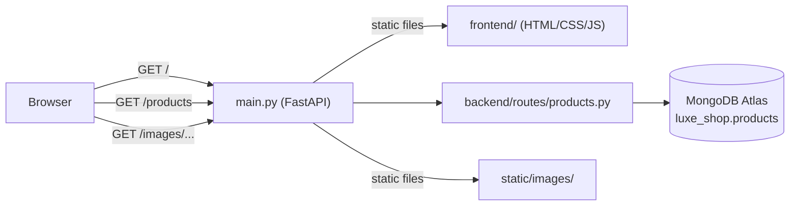
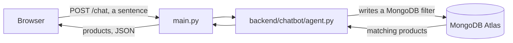

# 2 · Architecture

## How a request flows right now

- `main.py` is the single entry point. It registers routes in a deliberate order:
  1. `app.include_router(products.router)` — `/products`, handled by Python code
  2. `app.mount("/images", ...)` — anything under `/images/` is served straight from disk
  3. `app.mount("/", ...)` — everything else falls through to the `frontend/` folder (registered **last**, so it never shadows the two routes above it)
- `backend/config.py` reads `.env` once into a typed `Settings` object at startup.
- `backend/database.py` opens one MongoDB connection (`db`), imported by every route that needs it.
- `frontend/src/main.js` fetches `/products` once, stores the full list in memory, and re-filters it client-side as category/price buttons are clicked — no repeated network calls per click.

## Where Phase 2 (the chatbot) plugs in

One new endpoint, one new file. Nothing about the store (routes, database
connection, frontend) changes — the chatbot is additive.

## Identity note

There are currently no user accounts, carts, or orders — this build is
scoped to what the proposal actually needs: a browsable catalogue and a
chatbot that queries it. Accounts/cart/checkout are not part of this build
unless asked for separately.
